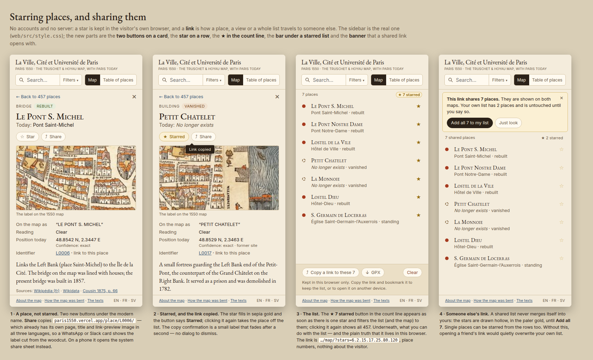
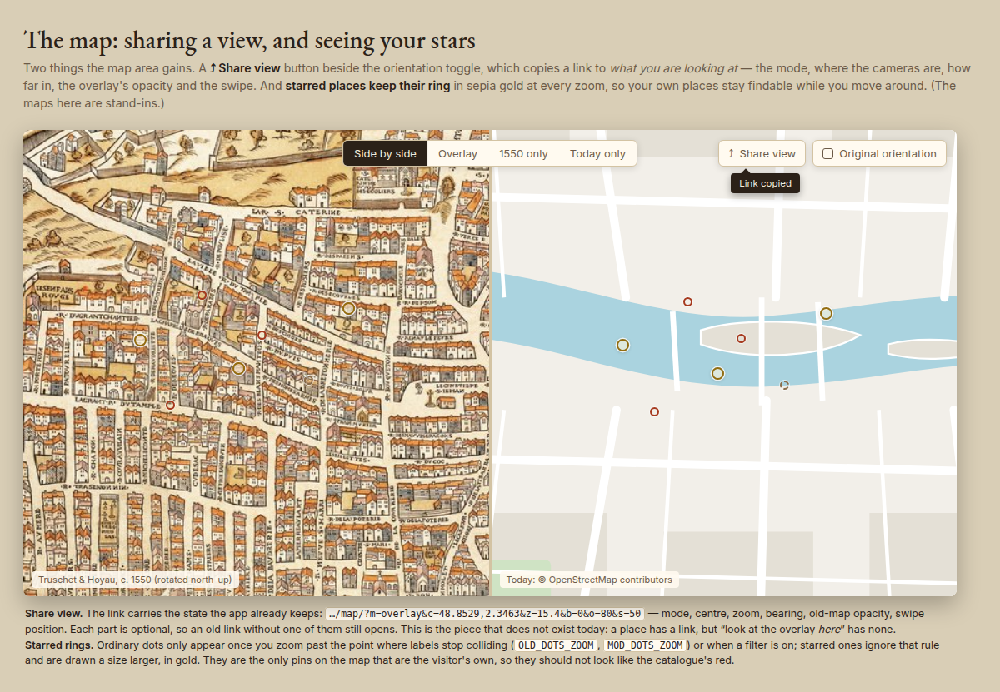
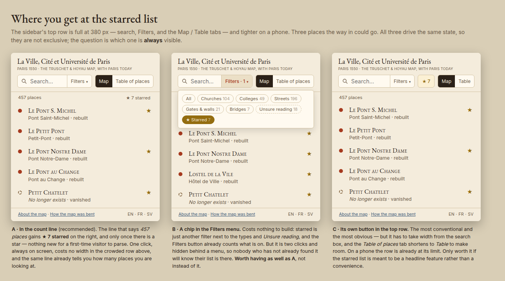
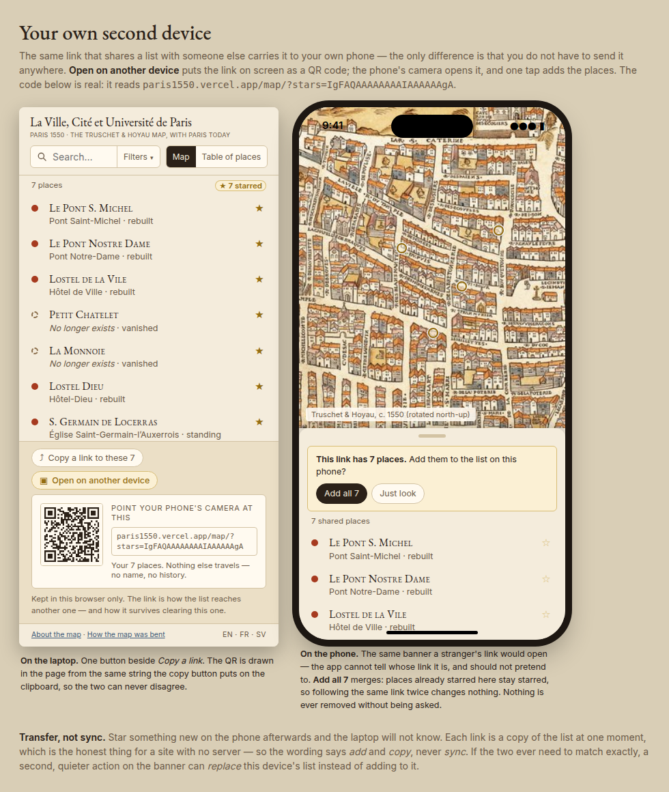

# Starred places and sharing (proposal, 2026-10-30)

What the owner asked for: *"a possibility to save favorites I find in the map, like starring them or
something, and the possibility to share locations."*

Mockups use the site's own stylesheet (`web/src/style.css`) and real records from
`data/places.json`; render them with `../../.venv/bin/python render.py`.

| | |
|---|---|
| [Starring and sharing](a-star-and-share.png) |  |
| [The map area](b-share-view.png) |  |
| [Where the list is reached](c-entry-points.png) |  |
| [Between your own devices](d-between-devices.png) |  |

## The constraint that shapes all of it

The site is static: HTML, JSON and tiles on Vercel, no server, no accounts, no cookies (Simple
Analytics only). Keeping that is worth more than cross-device favourites, so:

- **a star lives in the visitor's own browser** (`localStorage`, as `lang` already does, in a
  `try/catch` — private windows and blocked storage must not throw), and
- **a link is the only way anything travels**: to another person, or to your own phone.

Everything below follows from those two lines. An account system would mean a database, sign-in,
a privacy policy and a consent banner on a site that today collects nothing.

## Four pieces

### 1 · Star a place
A **☆ Star** button on the card, under the modern name, and a star on each row in the list (shown on
hover, always visible once set). Starred rows keep a filled gold star; clicking it again unstars.

### 2 · The list
**★ 7 starred** appears in the count line as soon as there is one star, and filters the list *and both
maps* to them — the existing `setFilter()` path, nothing new in the map code. A bar under the list says
what can be done with it, and says plainly that it is kept in this browser only. On the map, starred
places keep a gold ring at every zoom, where ordinary dots fade out above `OLD_DOTS_ZOOM` /
`MOD_DOTS_ZOOM`.

### 3 · Share one place — *mostly already built*
Every place is already a real page with its own title, description and link-preview image in all three
languages (`/place/L0006/`, `og/L0006.jpg`, built by `vite.config.ts` + `scripts/make_og_images.py`), so a
WhatsApp or Slack card already shows the label cut from the woodcut. What is missing is a **button that
says so**: one that copies the link on a desktop and opens the system share sheet
(`navigator.share`) on a phone. The permalink is in the card today, but as a line of a definition
list — nobody reads it as "send this to someone".

### 4 · Share a view, and share a list — *the real gap*
- **⤴ Share view** in the map area: `…/map/?m=overlay&c=48.8529,2.3463&z=15.4&b=0&o=80&s=50` — mode,
  centre, zoom, bearing, old-map opacity, swipe. Today "look at the overlay *here*" cannot be sent to
  anyone. Each parameter is optional, so a link that predates a new one still opens.
- **A link to the whole starred list**: `…/map/?stars=6.2.15.17.25.80.120`, the numeric part of the
  ids. Opening it shows those places with a banner — *add them to my list*, or *just look*. A shared
  list never merges itself in; stars from a link are drawn hollow until the visitor accepts them.

**The encoding rule:** index by the **id number** (`L0017` → 17), never by the row's position in
`places.json`, which shifts whenever a place is added. Readable commas up to ~60 places (~250
characters); beyond that a base64url bitmap of the ids (59 bytes, ~79 characters, for all 457 — and it
stays short however many are starred). The ids must then never be reused for a different place.

## Where the way into the list goes (sheet C)

| | For | Against |
|---|---|---|
| **A · in the count line** (recommended) | one click, always on screen, costs no width in the top row, appears only once there is a star | small and quiet; a first-time visitor will not notice it (which is the point until they star something) |
| **B · a chip in the Filters menu** | free — starred is just another filter beside the types and *Unsure reading*, and the Filters button already counts what is on | two clicks, behind a menu |
| **C · its own button in the top row** | the most conventional, impossible to miss | takes width from the search box at 380 px, and the phone row is already at its limit |

They drive the same state, so **A + B** can both exist; the question is only which is always visible.
Recommendation: **A**, with **B** thrown in because it is nearly free.

## What this does not do

- **No sync between devices** except by copying the link. The bar under the list says so rather than
  letting someone believe a star is safe.
- **No link preview for a shared view or list.** A query string never reaches a static file, so
  `?stars=…` and `?m=overlay…` links get the generic site card. A custom one would need a serverless
  OG function — a first piece of runtime on a site that has none. Worth it only if sharing lists
  turns out to be used.
- **No names or notes on a list** (a "walk along the right bank"), no ordering. Both are easy to add
  later: `&t=` on the link, and the list in the order they were starred.

## Cost

New: `src/stars.ts` (the list + storage), `src/share.ts` (links, clipboard, `navigator.share`),
`src/viewstate.ts` (read and write the `?m=…` parameters). Touched: `card.ts` (two buttons),
`main.ts` (count line, filter, the shared-link banner), `maps.ts` (a `starred` property on the dots
and one `case` expression), `style.css`, `strings.ts` (about 25 strings × 3 languages — the French and
Swedish need the owner's review, as the rest did).

Rough order of work: 1 and 2 are a day; 3 is an hour on top of what exists; 4 is the other half of
the day, most of it in getting the camera state in and out of the address without fighting the
`history.replaceState` the app already does for `/place/` links.

## Decisions (owner, 2026-10-30)

1. **A + B**: the ★ count in the count line, and the chip in the Filters menu. Not C.
2. Called **Starred** (FR and SV wordings still to settle with the translations).
3. **No GPX** for now — a distraction.
4. **No free pins**: only the 457 catalogued places can be starred or shared.
5. **The list link is the way between your own devices** — sheet D. Not a separate mechanism: the
   same `?stars=` link, offered as a QR code so a phone camera can take it without typing, and
   merging rather than replacing when it is opened.

## Built

All of it, on branch `starred-places` (2026-10-30), with `scripts/check_stars.py` to walk it in a
browser. Not deployed. See the LOG entry for what the checks turned up.

## Sheet D · the same link, between your own devices

`Copy a link to these 7` is joined by **Open on another device**, which draws the link as a QR in the
page — from the same string the copy button puts on the clipboard, so the two can never disagree.

- **Merge, never replace.** Opening a list link adds places that are not already starred and touches
  nothing else, so following the same link twice changes nothing and no star is ever lost. A
  *replace this device's list* action can sit quietly beside it if the two ever need to match.
- **The app cannot tell whose link it is**, and does not pretend to: a phone opening your own link
  shows the same banner a stranger's link would.
- **Transfer, not sync.** A link is the list at one moment. Star something afterwards on the phone
  and the laptop will not know. The wording says *add* and *copy*, never *sync*.
- **One parameter, two forms.** `?stars=2.6.15.17.25.80.120` while that is short, and the base64url
  bitmap (`?stars=IgFAQAAAAAAAAIAAAAAAgA`) once it is not — whichever is shorter. The decoder tells
  them apart by whether the value is digits and dots. Trailing zero bytes are trimmed, so the bitmap
  grows only as far as the highest starred id: 22 characters for these seven, 79 for all 457.
