# Intro page, welcome card and "start over" title: suggestions for review

Branch `intro`. Screenshots taken in Chromium (Playwright) from `vite preview`, without the map tiles
(so the old map is blank) and without OpenFreeMap (blocked in the cloud sandbox).

## 1. The title is a "Back to the start" link (built)

Clicking "La Ville, Cité et Université de Paris" returns to the standard view: list, no search, no
filters, side by side, north up, whole city, table → map, URL `/` (keeps `?lang=`). Hover: soft
background, title turns red. Tooltip "Back to the start" / « Revenir au début » / "Tillbaka till början".
Ctrl/⌘-click opens `/` in a new tab like any link. On the phone the title only shows with the sheet
pulled up full; there it also drops the sheet back to peek.

| Before (place open, overlay, original orientation, hovering the title) | After |
|---|---|
| 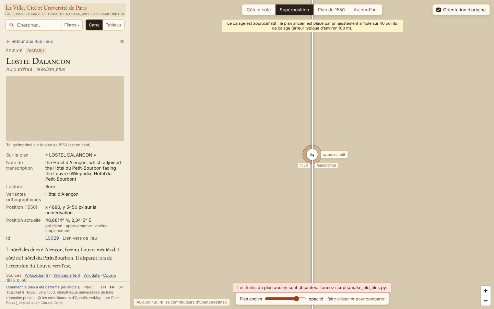 | 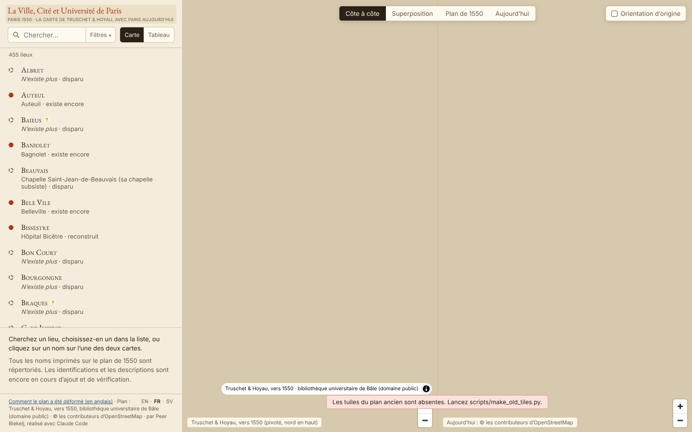 |

| Phone, before (sheet full, place open, overlay) | Phone, after |
|---|---|
| 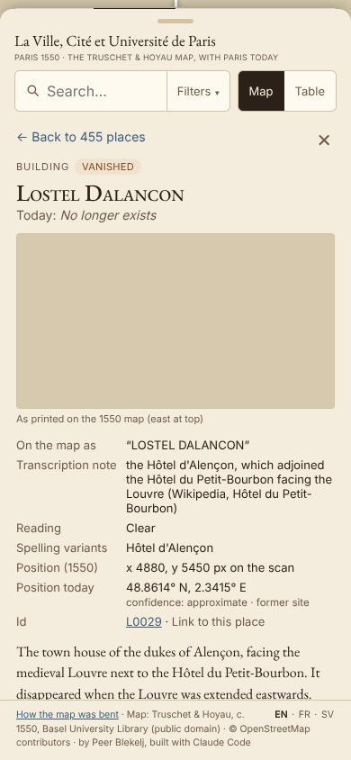 | 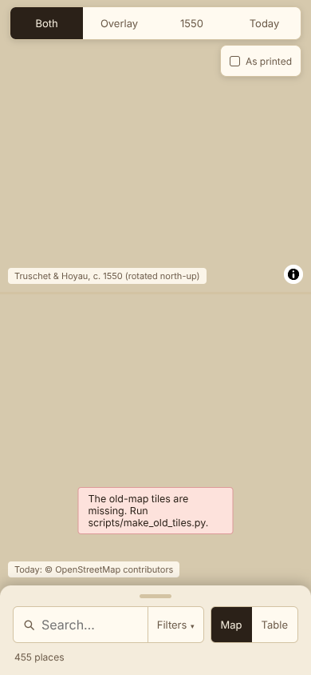 |

## 2. Intro page `/about/` (draft)

Text in `web/about/index.html`, same look as the method page. The striped boxes are placeholders for
details to cut from the scan: `<figure data-crop="x,y,w,h">`, in sheet pixels as printed (east up).

| Desktop | Phone |
|---|---|
| 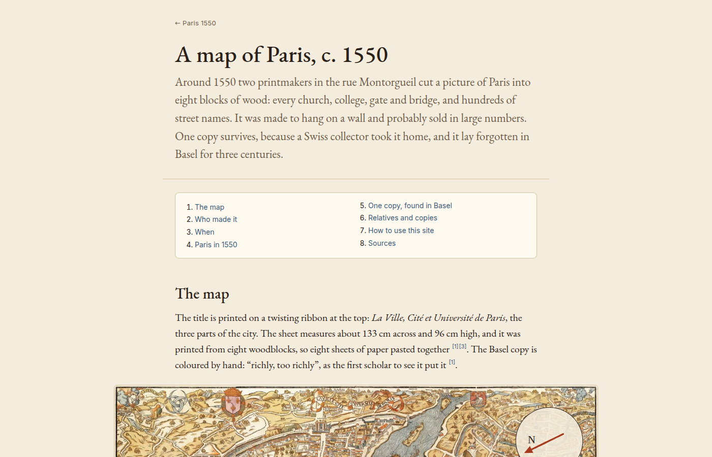 | 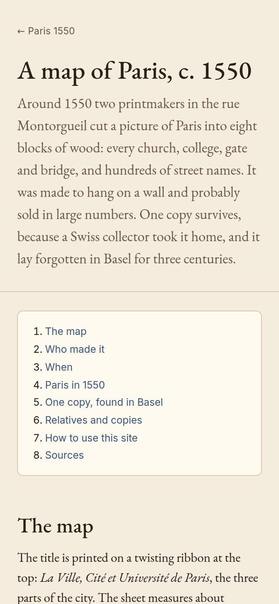 |
| 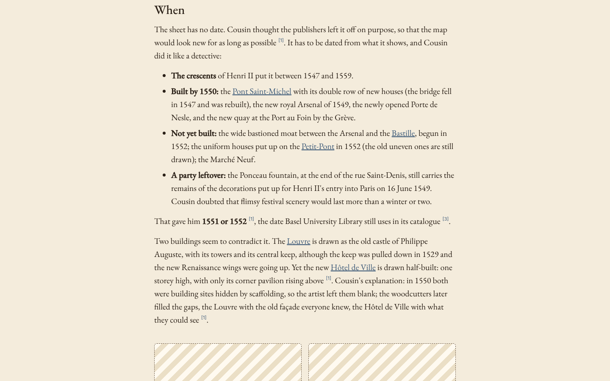 | 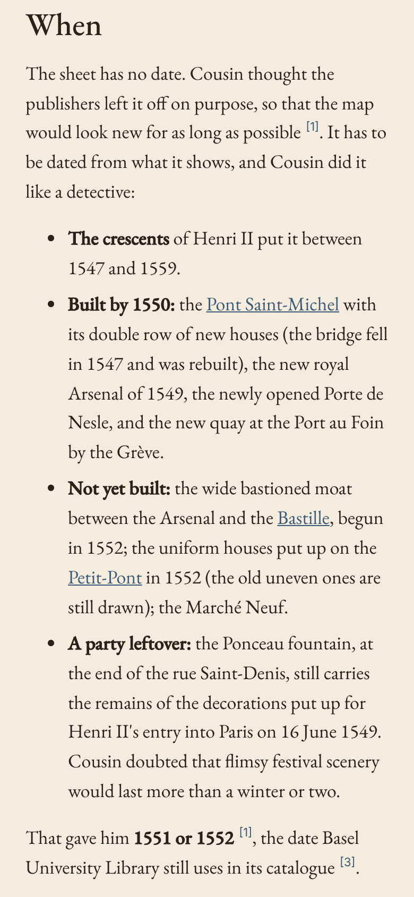 |

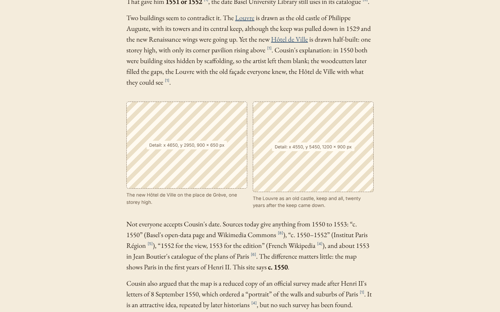

## 3. How visitors reach it

- Footer: "About the map" before "How the map was bent" (built).
- Welcome card above the list, on first visit only; × or following the link hides it for good (this
  browser). Switch: `WELCOME_CARD` in `web/src/welcome.ts`.

| Desktop | Phone (sheet at half) |
|---|---|
| 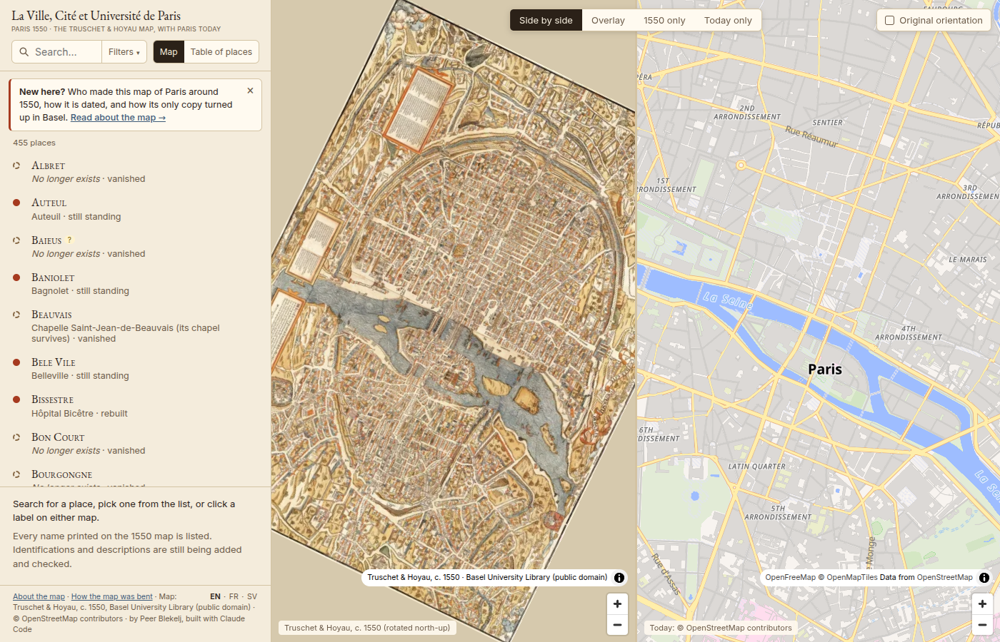 | 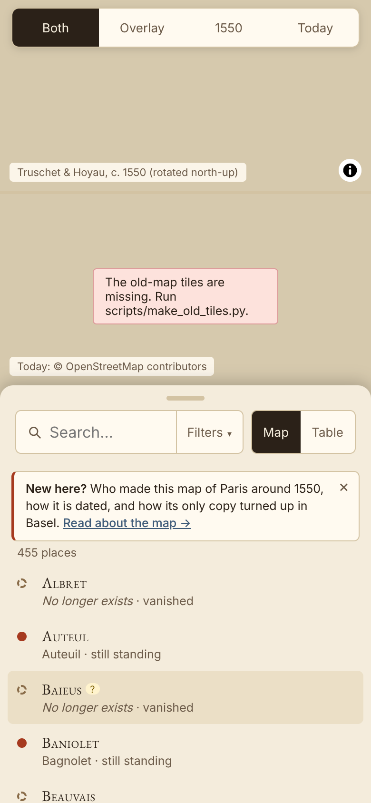 |
