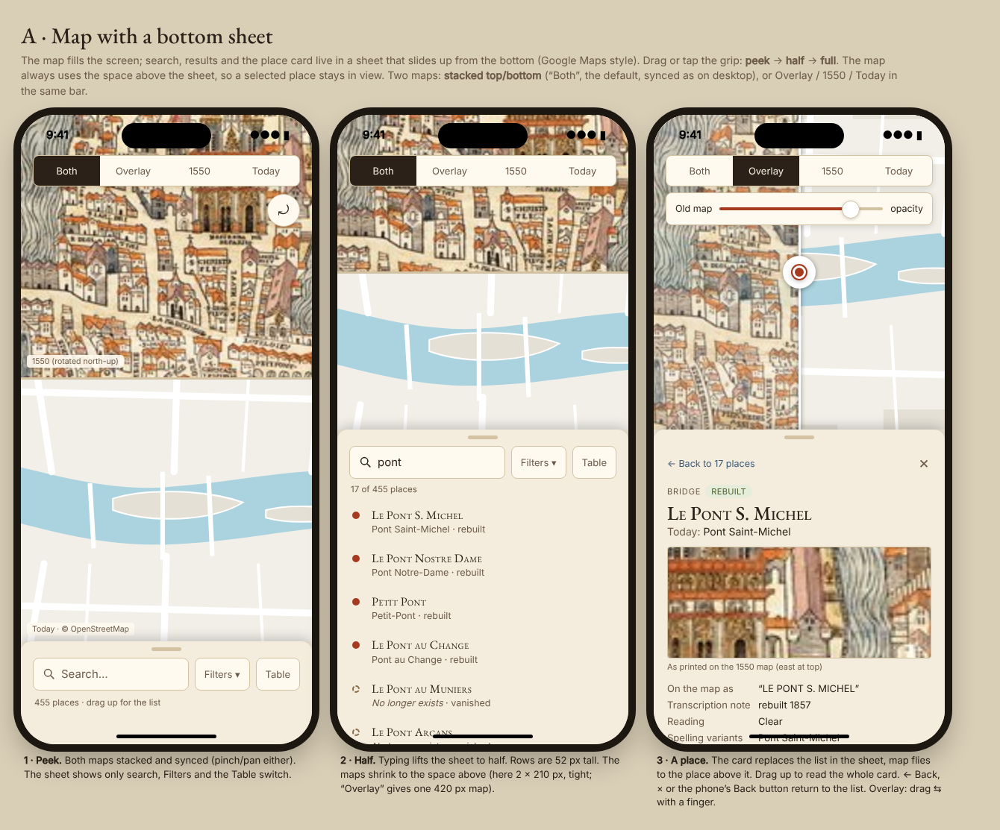
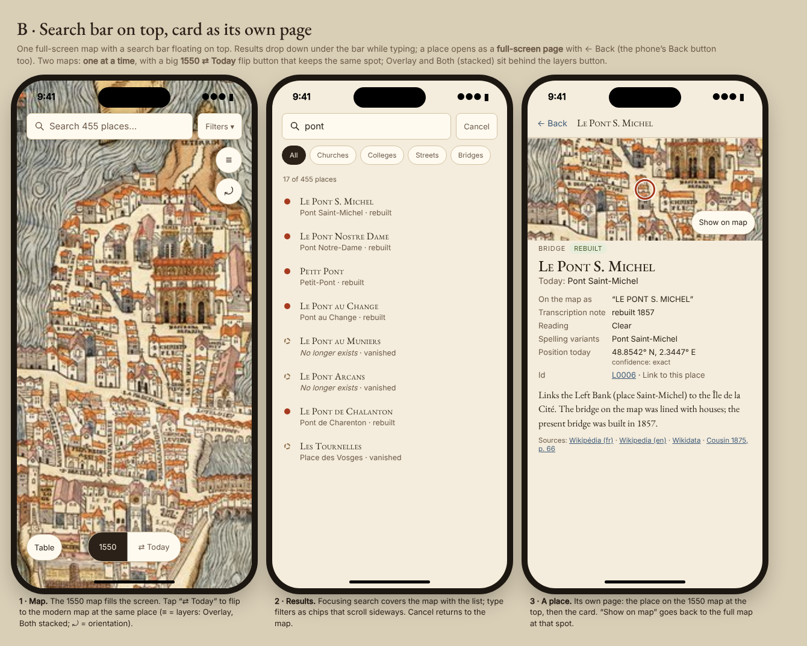
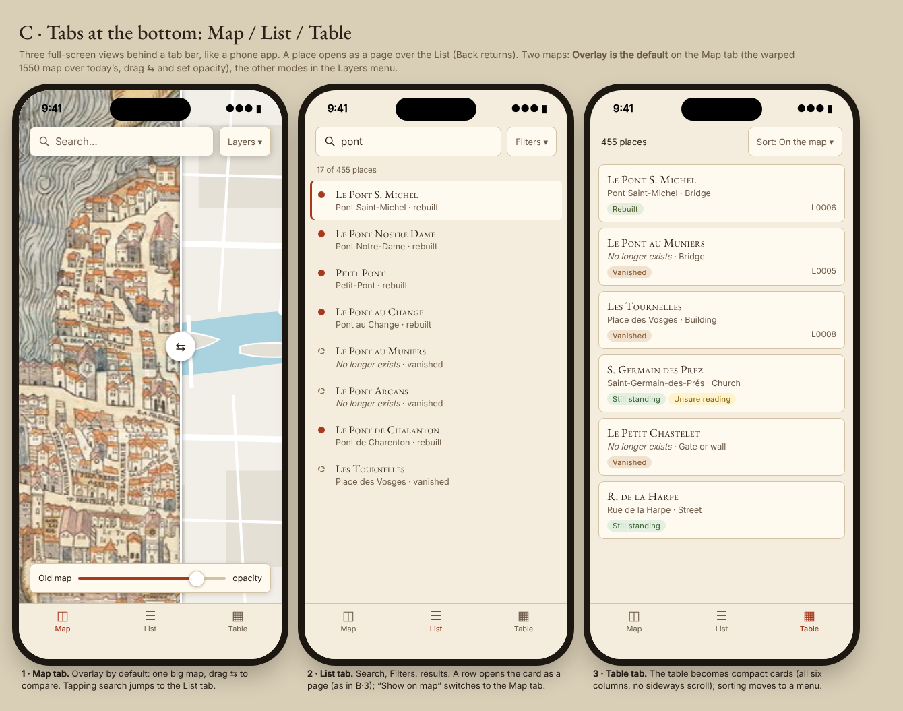

# Phone layouts (390 × 844)

Three options for screens below ~760 px. Static HTML using the site's own stylesheet
(`web/src/style.css`: palette, fonts, result rows, card, badges), rendered with `node render.js *.html`
(Playwright). The maps are stand-ins: a crop of `../overview.jpg` for 1550 and a drawn sketch for today.

| | |
|---|---|
| [A · bottom sheet](a-bottom-sheet.png) |  |
| [B · top bar, card page](b-top-bar.png) |  |
| [C · tabs](c-tabs.png) |  |

## A · Map with a bottom sheet (recommended, and built on branch `mobile`)

The map fills the screen; the desktop sidebar becomes a sheet that snaps to peek (search only),
half and full. The map always takes the space above the sheet, so a place you pick stays in view
while its card is open. Two maps: **stacked top/bottom** ("Both", the default, synced as on desktop),
with Overlay / 1550 / Today in the same bar at the top.
- **For:** map and card visible together, which is what the site is about (where was it, what is
  there now). It is the desktop drill-in turned on its side, so it reuses the same DOM and code:
  the build is one CSS file and ~150 lines of TS. Familiar from Google/Apple Maps.
- **Against:** a sheet needs a drag gesture that some people don't find; with the sheet at half
  the two stacked maps are only ~210 px tall each (Overlay gives one 420 px map).

## B · Search bar on top, card as its own page

One full-screen map, a floating search bar; results cover the map while typing; a place opens as a
full-screen page with ← Back and a strip of the 1550 map. Two maps: **one at a time**, with a large
1550 ⇄ Today flip button; Overlay and stacked behind a layers button.
- **For:** the simplest to understand; the card gets the whole screen and is easiest to read.
- **Against:** you never see the card and the map together, and comparing 1550 with today means
  flipping, so the side-by-side idea is mostly lost. Needs a separate page view and a mini map
  (a third MapLibre instance or a static crop).

## C · Tabs at the bottom: Map / List / Table

Three full-screen views behind a tab bar; a place opens as a page over the List. Two maps:
**Overlay is the default** (swipe ⇆ + opacity), other modes in a Layers menu. The table becomes
compact cards with a sort menu.
- **For:** app-like and predictable; each view gets the whole screen; the table works best here.
- **Against:** the tab bar costs ~83 px on every screen; most switching (list → card → map) is
  extra taps; the overlay default hides the 16th-century map's own drawing under modern streets.
  The most restructuring of the three.

## Recommendation

**A.** It keeps the one thing the site does that a list cannot, map and place together, and it is
the smallest change to the code. Open points for the owner: default mode on phones (A keeps
"Both", stacked; Overlay is the alternative), and whether the table on a phone should be compact
cards as in C·3 (the build keeps the real table with three columns: on the map, today, status).
